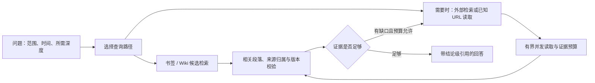

搜索与 Wiki 更新调研：ChatGPT、Perplexity、Grok 与 Bookmark Research
2026-10-10 · 已安装版本 0.5.0-beta.9

> 本文是当时的调研与设计建议；末尾“尚未落地”描述的是调研阶段。后续修复和仍待实现的扩展见 [2026-10-11 升级核对](upgrade-status-2026-10-11.md)。

**建议先补来源归属与时效判断，再优化候选检索、证据预算和并发调度。** 三家公开资料最有价值的共同方向，是让检索、阅读、判断是否继续搜索和生成引用成为可控制的流程。对我们的本地 Wiki，还需要独立建立网页版本与知识修订之间的更新关系。

本轮通过已安装插件的 `search_web`、`fetch_web` 检索并读取官方资料，对其中两份异常抓取另用单 URL 请求复核。共保存 15 个官方页面的选定提取结果、21 处支持性摘录和原始提供商响应。线上请求仅含公开产品问题和文档 URL，没有发送测试画布正文。以下区分产品文档、API 契约、厂商公开的架构说明与我们的建议；没有开展三家聊天产品的同题速度或准确率横评，也不推断未公开的内部实现。

| 对象 | 官方资料能确认的机制 | 对我们的启发 |
| --- | --- | --- |
| ChatGPT / OpenAI | ChatGPT 产品文档确认内置联网检索及多来源研究入口 [S01]。OpenAI API 明确区分快速查找、模型管理的多轮搜索和深入研究；支持搜索、打开页面、页内查找、来源清单及缓存/实时访问控制 [S02]。文件检索 API 支持关键词与语义检索，Retrieval 提供属性过滤、查询改写及混合排序控制 [S11][S12]。 | 按问题选择工作量；已知 URL 直接读取；对本地知识先召回相关段落；区分已访问来源与真正支撑答案的引用。API 能力不能直接视为 ChatGPT 消费产品内部实现。 |
| Perplexity | 2025 年架构文章披露词法与语义混合召回、逐级过滤和排序、后段 cross-encoder 重排、文档及段落级相关性，以及按重要性和预期更新频率安排重抓 [S03]。2026 年 Photon 文章披露按需读取、批量缓存、异步读取及索引构建与查询服务分离 [S04]；SaC 文章披露用模型生成的代码组合检索原语、并行、去重和过滤 [S05]。 | 最值得借鉴的是先扩大候选覆盖，再逐步花费计算，以及把机械性的批量工作放到代码中。我们的本地规模可先用 SQLite 和增量索引实现这些原则。 |
| Grok / xAI | Web Search 支持联网搜索和页面阅读 [S08]；X Search 包括关键词、语义、用户搜索及讨论串读取，提供账号与日期条件 [S09]。API 区分所有遇到的来源和正文引用 [S10]，并说明一轮中可能并行调用多个工具，轮数限制不等于调用数限制 [S14]。官方定时简报示例维护时间窗口、已覆盖故事及更新状态 [S15]。 | 将网站、社交动态、本地知识视为不同检索范围；保留来源类型和时间条件；记录真实执行次数和失败；更新任务维护检查进度和已处理版本。简报示例是应用实现，不代表 Grok 自动维护用户的任意 Wiki。 |

Perplexity 的现行 Search API 返回供程序处理的排序结果，生成带来源答案使用 Agent API [S06]。Agent API 文档将快速/标准搜索、结果数、总上下文 token 预算、每页预算分开控制 [S13]。这比只暴露一个“深入搜索”开关更适合做可解释的速度与质量取舍。

厂商公布的延迟与质量成绩来自其自身工作负载和评估。本报告采用其机制说明，不将 Photon 的服务端延迟或 SaC 的个别任务成绩换算为我们插件的预期收益。

本轮实际调用还发现了两个需要优先处理的问题。

| 问题 | 现场与回放证据 | 建议 |
| --- | --- | --- |
| 批量提取发生正文串页 | 请求每页 22,000 字符的五 URL 批次中，原始响应有 5 个页面记录；解析后只有 3 条。OpenAI File search 的正文变成 66,169 字符，包含后续 OpenAI Retrieval 与 Perplexity Web Search 的记录。另一批中，Perplexity Quickstart 的 56,117 字符正文混入后续日期过滤页面。 | 将来源归属作为发布前必须通过的正确性检查。优先使用逐 URL 的结构化结果；文本边界存在歧义时保留原始响应并重试单 URL，不把整块文本归给前一页。 |
| 输出预算没有端到端约束 | 请求每页 28,000 字符，Parallel 选中的日期过滤文档返回 177,529 字符。单 URL 复核时，请求 12,000 字符，Jina 返回的 OpenAI 文件检索页为 80,195 字符，Perplexity Quickstart 为 123,698 字符。 | 把提供商请求上限与返回给模型的预算分开；明确每页及整批上限、截取范围与继续读取方式。保留原始归档，给模型优先返回与问题相关的段落。 |

串页的具体触发点是提供商按字符截断页面时切进 Markdown 代码围栏。插件为避免把代码示例中的 URL 误认成页面边界，会先屏蔽围栏内容；上一页未闭合的围栏可能吞掉下一页头部，再被后续页面的围栏偶然闭合。此时整个批次看似闭合，解析器便接受了混合正文。[边界处理](/Users/kk/Downloads/chrome-download/Bookmark-Research/src/archive.py:155) · [页面切分](/Users/kk/Downloads/chrome-download/Bookmark-Research/src/archive.py:173)。

原始响应离线回放和一个两页合成样例都复现了这个问题。归档中保存的是错误归属的正文，所以其 SHA-256 和“引用确实存在于归档中”的检查仍可能通过。本次调研清单已排除两份混合提取结果，引用改用单 URL 复核版本；原始异常响应作为诊断材料保留，没有把它们接受为 Wiki claim。

两类超长情况应分别处理：Exa 批次中的超长主要来自串页；Parallel 适配层明确请求 `full_content:true`，没有传入字符上限，紧凑输出也没有再裁剪。[提供商参数](/Users/kk/Downloads/chrome-download/Bookmark-Research/src/provider_adapters.py:110) · [紧凑输出](/Users/kk/Downloads/chrome-download/Bookmark-Research/src/archive.py:278)。这些样本证明预算缺口，不构成服务商速度排名。

建议的查询流程如下。这是针对本插件的设计建议，不是三家产品内部流程的复刻。

查询路径可以先做三类。问“我存过哪些相关资料”，走本地索引及必要的画布上下文；问“这个产品现在多少钱”，优先复查已知官方定价 URL；问“这几种方案如何比较”，再进行多查询、多来源研究。快查没有解决证据缺口时可以升级，复杂问题也不应仅因某一家提供商返回了非空结果就停止。

现有跨提供商并行、Jina 批量读取和目录缓存已经有效，应在此基础上改进调度。独立的查询变体、独立 URL 读取可有界并行；依赖上一轮证据的补搜应顺序决策。同一个 Wiki 页面的提交、版本检查与写锁仍需保持一致性。宿主中同时发出两个调用，也不保证同一 MCP 连接上的服务端会并发执行。

LLM 适合负责问题拆解、证据是否支持结论、来源冲突与继续搜索的必要性；代码适合负责批量请求、去重、过滤、配额、结果裁剪和重试。SaC 支持这种分工 [S05]，但本插件可以先用已有批量 targets 和固定调度逻辑实现，不需要立即引入任意代码执行系统或互联网规模的自建索引。

对 Wiki 检索，最先改变的是执行顺序。前一轮实测中，300 个简单页面即使无命中也检查全部 300 个修订及证据，约 151 ms；词面“定价”能命中，“收费标准”“多少钱”不能命中。[此前 Wiki 审计](/Users/kk/Downloads/chrome-download/Bookmark-Research/docs/wiki-lifecycle-audit-0.5.0-beta.9.md)

建议先按标题、正文段落、实体别名、来源和时间条件建立索引，拿到候选后再校验证据；发现候选无效时继续补取，避免前几个失效条目吃掉全部结果名额。查询内可复用同一份证据的校验，但缓存键必须包含相关版本、哈希和撤回状态。全库完整性审计单独进行，并让结果区分“检索候选数”和“已校验结果数”。

中文检索要专门评估分词、短词与别名；普通按空格分词不能解决“多少钱 → 定价”。可以先做轻量别名与适合中文的全文索引，再根据真实问句的召回缺口加入向量检索和小候选集重排 [S11][S12]。现有书签查询的字面子串、精确计数与实例身份语义应继续保留。仅凭相关性分数高，也不能把已撤回或不符合时间条件的结论重新提升为可信答案。

给模型的默认结果应包括相关片段、Wiki 修订、源 URL、证据版本、时间状态和展开入口。保留完整归档供进一步读取；截取的片段必须能定位回原文，并明确是否覆盖完整页面。预算除了单页长度，还应包括整批结果、查询轮数、提供商调用数及总时限。不能把“发过 max_characters 参数”当作实际预算已经执行。

网页持续更新需要另一条生命周期链：

`书签实例 → URL 身份 → 网页快照版本 → claim / 证据片段 → Wiki 修订`

| 事件 | 建议行为 |
| --- | --- |
| 网页内容未发生实质变化 | 记录检查结果；在确实完成源站验证时推进源站检查时间；保留原有知识修订。 |
| 同 URL 出现新正文 | 保存新快照，定位引用旧版本的结论，标为待复核；比较相关事实后再生成新 Wiki 修订。内容哈希不同不等于所有结论都错误。 |
| 只改了无关书签标题 | 仅更新依赖该书签元数据的结论；不让整个书签包中的知识一起变成待复核。 |
| 用户问“现在”的价格、接口或产品能力 | 按时效策略复查已知来源；无法确认时说明最后确认时间和未解决的变化，不把旧值标为已确认现价。 |
| 用户问“2024 年时”的情况 | 按所问时间检索历史证据和修订；历史事实不应只因资料旧而被排除。 |
| 网页无法读取或提供商只返回缓存 | 保存失败/缓存来源状态；不把本次请求时间写成源站已验证时间。 |
| 网页标题更新 | 保存新的抓取元数据。书签的用户自定义标题、备注、标签和空间组织仍表达用户意图，需要按明确的同步规则处理。 |
| 关联 Wiki 更新或 claim 撤回 | 通过反向依赖定位受影响页面，并在检索时识别其复核/失效状态；并发修订继续使用 expected_revision。 |

至少分开三种状态：证据文件完整性、网页新鲜度、结论复核状态。时间也要区分页面声明的发布时间/更新时间、提供商抓取时间、我们获取内容的时间，以及有依据的源站检查时间。Perplexity API 对发布时间与更新时间提供不同过滤器 [S07][S13]，但这些索引元数据本身仍不能证明某条 Wiki 结论在当前适用。

TTL 可按内容变化频率配置，结合按需检查与计划检查。定价和接口文档的策略应区别于历史文章。能验证支持时使用 ETag/Last-Modified 和条件请求；正文变化检测应弱化导航、广告和动态时间戳。收到新内容后，先传播“需要复核”，再由规则、模型或审阅者判断具体事实是否变化，保留旧版本。后台更新应记录进度、预算和失败重试，进程退出后能恢复。

xAI 的定时简报示例展示了“从上次检查时间继续、记住已覆盖内容、区分新消息与更新”的应用模式 [S15]。Wiki 的要求更高，还要追踪具体结论与引用，不能仅靠“本周搜过这个主题”的记忆去判断知识已更新。

本轮建议的实施顺序如下。数值性能目标需要在固定负载与相同质量要求下建立基线后确定。

| 优先级 | 工作 | 验收重点 |
| --- | --- | --- |
| P0 | 修复批量正文归属，补齐端到端输出预算 | 两份现场响应、跨页截断围栏、正常代码内 URL 示例都正确处理；异常页面不进入可引用证据。超预算结果有明确片段范围和可用的继续读取方式。 |
| P1 | 分离完整性、新鲜度与复核状态，建立 URL/claim/Wiki 反向依赖 | 同 URL 价格 10 → 20 后，当前问答不再把旧价当作已确认值；无关书签改名不牵连整批；历史问答仍能取到 10 的历史依据。 |
| P1 | 候选优先的 Wiki 索引与增量维护 | 无命中查询不再逐页校验；单页写入不重建全部目录；“收费标准”等同义问法能找到相关材料；失效候选会补取或说明不足。 |
| P1 | 解除 MCP 队首阻塞，按问题选择调用预算 | 慢网络调用期间，本地查找仍可响应；并发、取消、超时和每页写入顺序正确；同时记录排队时间和实际执行时间。 |
| P2 | 基于评测加入语义召回、重排、按提供商能力调度 | 在可接受成本下改善真实问句的召回和引用支持率；过滤能力不支持时明确降级，不能静默忽略时间或来源约束。 |

前一轮已有性能证据：常见本地 MCP 查询约 1.6–5.5 ms，而一个模拟 600 ms 网络调用会把同连接的本地计数拖到约 609 ms；63,800 实例下重复 SQL 和全库状态统计也是主要开销。[此前性能审计](/Users/kk/Downloads/chrome-download/Bookmark-Research/docs/performance-audit-0.5.0-beta.9.md) 因此优化应同时覆盖调度与检索工作量，不能只减少工具名称或缩短提示词。

评测应采用相同问题、相同模型、明确的提供商与预算，保留一组未参与调参的题目。先用可控回放测正确性和排队，再用真实网络重复采样。推荐从少量真实问题开始，覆盖下面的场景。

| 场景 | 主要指标 |
| --- | --- |
| 中文同义问法、缩写、精确 URL/ID、跨页面问题 | 候选 Recall@k、答案相关性、是否保留书签实例及范围 |
| 当前问题、历史问题、同 URL 新旧内容冲突 | 把过期事实当作现状的比例、历史版本命中、复核状态正确性 |
| 同源重复内容、引用撤回、无关书签变化 | 引用支持率、错误复核比例、更新涉及的无关页面数量 |
| 截断围栏、混合页面、访问失败、正文缺失 | 来源归属正确率、异常是否进入答案、恢复路径是否可用 |
| 本地小库/大库、慢或失败提供商、取消 | 首批可用证据时间、总时延 p50/p95、排队时长、错误与覆盖率 |
| 相同质量下的快查和研究 | 提供商调用次数、模型输入 token、输出体积、成本；不以来源链接数量替代证据质量 |

引用支持率应检查“这段原文能否支持这条结论”，并保留需要时的人工复核。URL 可打开、原文哈希匹配、模型给出高置信度，都不能单独替代这一检查。判定停止搜索时也应考虑问题覆盖、关键依据和仍未解决的冲突，而不是只看结果非空。

以下是实际读取的官方来源。S06 与 S11 使用单 URL 复核版；所有提取都只用于其中已核对的段落，工具未证明读到了完整原始网页。

| 编号 | 资料 | 本报告采用的证据类型 |
| --- | --- | --- |
| [S01] | ChatGPT Learn — Web search | 产品文档；其中 Codex 专属配置不外推给所有 ChatGPT 用户 |
| [S02] | OpenAI — Web search | Responses API 契约与公开的搜索分层 |
| [S03] | Perplexity — Architecting and evaluating an AI-first Search API，2025-09-25 | 厂商架构披露 |
| [S04] | Perplexity — Photon，2026-09-24 | 厂商架构披露 |
| [S05] | Perplexity — Rethinking search as code generation，2026-06-01 | 厂商参考架构与实现披露 |
| [S06] | Perplexity Search API | 当前 API 用途说明 |
| [S07] | Perplexity — Search Date and Time Filters | Search API 日期过滤契约 |
| [S08] | xAI — Web Search | API 能力 |
| [S09] | xAI — X Search | API 能力及过滤范围 |
| [S10] | xAI — Citations | 来源与答案引用的区分 |
| [S11] | OpenAI — File search | API 关键词与语义检索能力 |
| [S12] | OpenAI — Retrieval | API 属性过滤、改写与混合排序 |
| [S13] | Perplexity Agent API — Web Search | 当前 API 搜索档位、上下文预算和结果来源字段 |
| [S14] | xAI — Tool Usage Details | 调用、成功执行、轮数及并行的区分 |
| [S15] | xAI — Topics to Morning Briefing | 官方应用示例；不当作消费者产品内部机制 |

[S01]: https://learn.chatgpt.com/docs/web-search
[S02]: https://developers.openai.com/api/docs/guides/tools-web-search
[S03]: https://www.perplexity.ai/hub/blog/architecting-and-evaluating-an-ai-first-search-api
[S04]: https://www.perplexity.ai/hub/blog/photon
[S05]: https://www.perplexity.ai/hub/blog/rethinking-search-as-code-generation
[S06]: https://docs.perplexity.ai/docs/search/quickstart
[S07]: https://docs.perplexity.ai/docs/search/filters/date-time-filters
[S08]: https://docs.x.ai/developers/tools/web-search
[S09]: https://docs.x.ai/developers/tools/x-search
[S10]: https://docs.x.ai/developers/tools/citations
[S11]: https://developers.openai.com/api/docs/guides/tools-file-search
[S12]: https://developers.openai.com/api/docs/guides/retrieval
[S13]: https://docs.perplexity.ai/docs/agent-api/tools/web-search
[S14]: https://docs.x.ai/developers/tools/tool-usage-details
[S15]: https://docs.x.ai/cookbook/examples/topics-to-morning-briefing

资料与复现保存在 [调研目录](/Users/kk/Downloads/bookmark-search-research-20261010-_mvbu2ay/README.md)。其中 [来源清单](/Users/kk/Downloads/bookmark-search-research-20261010-_mvbu2ay/source-manifest.json) 记录 URL、选定提供商、获取时间、正文哈希、原始响应路径及排除的混合提取；[支持性摘录](/Users/kk/Downloads/bookmark-search-research-20261010-_mvbu2ay/evidence-snippets.json) 可逐条核对；[离线回放结果](/Users/kk/Downloads/bookmark-search-research-20261010-_mvbu2ay/diagnostics.json) 记录来源边界与预算异常。

本轮完成公开资料调研、现场抓取检查与离线复现。插件运行时代码尚未修改，建议中的修复和新检索机制尚未落地；没有更新用户的真实 Wiki 或书签包。
